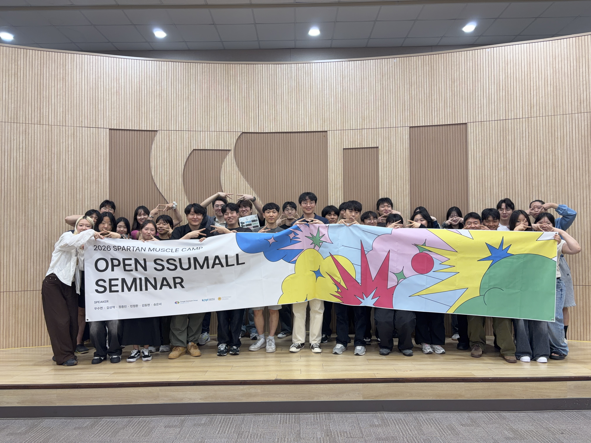

# GDG-WEB-2026 DEV
[WEB PAGE](https://gdgocsoongsil.com/)

# 블로그 글 작성 안내

### 1. 파일 위치 및 이름 규칙

`content/posts/` 폴더 안에 `.mdx` 파일을 생성해요.

```
content/posts/파일명.mdx
```

- 영문, 숫자, 하이픈(`-`)만 사용
- 파일명이 URL의 slug가 됨 (예: `my-post.mdx` → `/blog/my-post`)
- 행사 후기처럼 날짜가 있는 글은 `2026-open-SSUmall-Seminar.mdx` 형식 권장

---

### 2. 상단 메타데이터 (Frontmatter, 필수)

파일 맨 위에 `---`로 감싼 frontmatter를 반드시 작성해야 해요.

```mdx
---
title: "글 제목"
date: "2026-06-20"        # YYYY-MM-DD 형식 (최신 글이 목록 상단에 표시됨)
description: "글 요약"    # 블로그 목록 카드에 표시됨
author: "작성자 이름"
tags: ["행사", "태그2"]   # 선택사항, 글 상단에 뱃지로 표시됨
---
```

---

### 3. 본문 작성 (Markdown 문법)

frontmatter 아래부터 Markdown 문법으로 자유롭게 작성해요.

```mdx
## 소제목 (h2)
### 소소제목 (h3)

일반 문단 텍스트입니다.

**굵게**, *기울임*, `인라인 코드`

- 목록 항목 1
- 목록 항목 2

[링크 텍스트](https://링크주소)

---   ← 구분선
```

코드 블록:
````mdx
```javascript
console.log('Hello!')
```
````

---

### 4. 이미지 삽입

#### 4-1. 이미지 파일 위치

이미지는 `public/blog/` 하위에 글별 폴더를 만들어 정리해요.

```
public/
  blog/
    2026-open-SSUmall-seminar/   ← 글 slug와 동일한 이름 권장
      단체사진.JPG
      발표자1.jpg
      ...
```

#### 4-2. 이미지 경로 규칙

MDX 파일 안에서는 `/blog/폴더명/파일명` 형식으로 참조해요.  
`public/` 앞부분은 적지 않아요.

```mdx
# 올바른 경로


# 잘못된 경로 (public/ 포함 X)

```

> Obsidian에서 이미지를 삽입하면 경로가 `public/blog/...` 형식으로 잘못 삽입될 수 있어요. 반드시 `/blog/...`로 수정해주세요.

#### 4-3. 이미지 1장 (기본)

```mdx

```

#### 4-4. 이미지 2장 나란히 배치 (2열 레이아웃)

2장을 한 줄에 가로로 나란히 넣고 싶을 때는 HTML을 직접 작성해요.

```mdx
<div style={{display: 'flex', gap: '12px', margin: '24px 0'}}>
  
  
</div>
```

#### 4-5. 이미지 캡션 (이미지 아래 회색 설명글)

이미지 바로 아래에 캡션을 달고 싶을 때는 `<p>` 태그를 사용해요.

```mdx
<div style={{display: 'flex', gap: '12px', margin: '24px 0'}}>
  
  
</div>
<p style={{fontSize: '13px', color: '#9ca3af', marginTop: '-12px', marginBottom: '24px'}}>캡션 텍스트를 여기에 적어요</p>
```

---

### 5. 로컬에서 미리보기

MDX 파일을 수정하거나 새로 추가한 뒤에는 반드시 **개발 서버를 재시작**해야 반영돼요.  
(빌드 시 `scripts/generate-posts.mjs`가 실행되어 MDX → HTML로 변환하기 때문)

```bash
# 개발 서버 재시작
npm run dev
```

서버가 뜨면 아래 주소에서 확인해요:

```
http://localhost:3000/blog/파일명-slug
```

예: `content/posts/2026-open-SSUmall-Seminar.mdx` → `http://localhost:3000/blog/2026-open-SSUmall-Seminar`

---

### 6. 주의사항

- `date` 형식이 틀리면 목록 정렬이 깨질 수 있어요 → 반드시 `"YYYY-MM-DD"` 형식
- MDX 안에서 HTML/JSX를 사용할 때 style 속성은 `style={{...}}` (중괄호 두 겹) 형식으로 작성해요
- `src`, `alt` 등 속성값의 따옴표 누락 시 파싱 오류가 발생해요. 꼼꼼히 확인해주세요
- 이미지 파일명에 한글이 포함되어도 동작하지만, 영문 파일명을 권장해요

---

### 7. PR 안내

블로그 글 작성이 완료되면 PR을 올려 Organizer의 검토를 받아야 해요.

- PR을 올릴 때 **해당 기수 Organizer를 Reviewer로 등록**해주세요
- **Merge는 반드시 Organizer가 직접 진행**합니다. 본인이 직접 Merge하지 마세요

---

## 🌱 Commit Convention

- 커밋 메시지 규칙
  - `commit convention`: `commit message`
  - 예시) `feat: 로그인 구현`

| Tag Name | Description                                                                                   |
| :-- | :-------------------------------------------------------------------------------------------- |
| ✨ | 새로운 기능 추가                                                                              |
| 🎨 | CSS 등 사용자 UI 디자인 변경                                                                  |
| 💬 | 필요한 주석 추가, 변경 및 삭제                                                                |
| 🔧 | 버그 수정                                                                                     |
| ♻️ | 프로덕션 코드 리팩토링, 새로운 기능이나 버그 수정없이 현재 구현을 개선한 경우                  |
| 📝 | README.md 수정                                                                                |
| 📁 | 파일 혹은 폴더명을 수정하거나 옮기는 작업만인 경우                                            |
| 🗑️ | 파일을 삭제하는 작업만 수행한 경우                                                            |
| 🧪 | 테스트 코드, 리펙토링 테스트 코드 추가, Production Code(실제로 사용하는 코드) 변경 없음       |
| 🧹 | 빌드 업무 수정, 패키지 매니저 수정, 패키지 관리자 구성 등 업데이트, Production Code 변경 없음 |
| 🚑️ | 급하게 치명적인 버그를 고쳐야하는 경우                                                        |

## 🪵 Branch Convention
| issue | Description                                                                                   |
| :-- | :-------------------------------------------------------------------------------------------- |
| feature | 새로운 기능 추가                                                                              |
| design | CSS 등 사용자 UI 디자인 변경                                                                  |
| fix | 버그 수정                                                                                       |
- Issue를 생성한다. (작업의 단위, 번호 부여)
- Issue의 Feature Branch를 생성한다.
  - `{접두사}/#이슈번호_{작업명}`
  - 예시: feat/#12_login
- Add - Commit - Push - Pull Request 의 과정
- Pull Request가 작성되면 다른 팀원이 Code Review를 한다.
- Code Review가 완료되고, 다른 팀원이 Approve하면 Merge Pull Request 진행
- 다른 팀원은 merge된 작업물을 pull하고 다시 각자 맡은 작업을 이어나간다.
